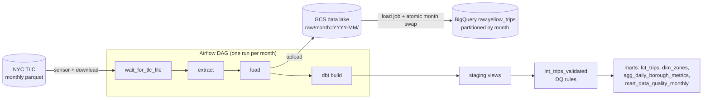

# NYC Taxi ELT Warehouse

[](../../actions/workflows/ci.yml)

An end-to-end, batch ELT pipeline that turns the public [NYC TLC yellow taxi trip records](https://www.nyc.gov/site/tlc/about/tlc-trip-record-data.page) (~3M trips a month) into a tested, analytics-ready warehouse on **BigQuery**.

**Stack:** Airflow 3 (Docker) · Google Cloud Storage · BigQuery · dbt · Terraform · GitHub Actions. The same pipeline also runs fully locally on DuckDB, with no cloud account, which is what CI uses.



## What this project demonstrates

| Concern | How it's handled |
|---|---|
| **Idempotency** | Every load deletes and re-inserts its month inside one transaction, and `fct_trips` is incremental per month (`insert_overwrite` on BigQuery). Re-running or backfilling a month replaces it and never duplicates it. Covered by tests. |
| **Late-arriving source** | TLC publishes about two months late. A reschedule-mode sensor checks twice a day for up to 60 days without holding a worker slot. |
| **Schema drift** | TLC files changed over the years (column casing, int vs float, `airport_fee` added in 2022). The loader projects every file onto one canonical schema and fills missing columns with typed NULLs. |
| **Data quality** | 32 dbt data tests plus a dbt unit test. Bad trips are flagged with a reason, not silently dropped, and a threshold test fails the run if more than 10% of a month is invalid (for example a truncated file). Failing rows are stored in a `dq_failures` dataset for debugging. |
| **Cost and performance** | `fct_trips` is partitioned by pickup month and clustered by zone. dbt has a 20 GB per-query `maximum_bytes_billed` guardrail, landed files expire after 90 days, and Terraform can create a budget alert. |
| **Infrastructure as code** | Terraform creates the bucket, datasets and a least-privilege service account (dataset-level `dataEditor`, bucket-level `objectAdmin`). |
| **Portability and CI** | The dbt models use cross-database macros, so the same SQL runs on BigQuery and DuckDB. CI loads a bundled 20k-row sample and runs `dbt build` on DuckDB, plus pytest, ruff, and a DAG import check in the real Airflow image. |

## Data model

| Model | Grain | Notes |
|---|---|---|
| `raw.yellow_trips` | one row per published record | Written by Airflow, partitioned by `source_month` |
| `stg_yellow_trips` | one row per trip | Renamed and typed. Exact duplicates are removed and `trip_id` is a surrogate hash key |
| `stg_taxi_zones`, seeds | one row per zone or payment code | From the TLC zone lookup and data dictionary |
| `int_trips_validated` | one row per trip | Adds `is_valid` and `dq_issue` (8 rules: pickup outside file month, non-positive or >6h duration, zero or >200 mi distance, negative or >$1000 amount, missing zone) |
| `fct_trips` | one row per **valid** trip | Incremental, partitioned and clustered, with duration, speed and payment type |
| `dim_zones` | one row per zone | Includes borough and an airport flag |
| `agg_daily_borough_metrics` | day × pickup borough | Trips, revenue, average fare, distance and duration, card tip rate, airport pickups |
| `mart_data_quality_monthly` | month × DQ outcome | How many trips each rule rejected |

Run `make docs` to browse the full lineage graph and column docs.

On the bundled January 2021 sample, 97.6% of trips pass. The most common issues are zero-distance trips (1.4%) and dropoffs before pickups (0.4%).

## Running it

### 1. Locally on DuckDB (about 2 minutes, no cloud account)

```bash
make init      # creates .env and a virtualenv
make sample    # loads the 20k-row sample and runs dbt build (models + 33 tests)
make test      # pytest + ruff
```

To run real data through Airflow:

```bash
make up        # Airflow UI on http://localhost:8080
```

Then unpause `nyc_taxi_elt`. It backfills one run per month from `START_MONTH` in `.env`. To run a single month without the scheduler, use `docker compose exec airflow airflow dags test nyc_taxi_elt 2025-07-01`, which processes June 2025. The run dated the 1st of a month processes the month before it.

### 2. On BigQuery

Prerequisites: a GCP project with billing enabled, plus `gcloud` and `terraform` installed. Everything fits comfortably in BigQuery's free tier (1 TB of queries and 10 GB of storage a month). A year of data uses roughly 10 to 15 GB including the marts, which costs well under $1 a month.

```bash
gcloud auth application-default login
cp terraform/terraform.tfvars.example terraform/terraform.tfvars   # set project_id
make tf-apply      # bucket, datasets, service account (+ budget alert if billing_account_id set)
make tf-key        # writes secrets/gcp-key.json (git-ignored)
terraform -chdir=terraform output env_file_snippet   # paste into .env
make up            # same DAG, now loading into GCS + BigQuery
```

`make month MONTH=2025-06` runs the same steps for one month without Airflow. `make tf-destroy` removes everything.

## Repository layout

```
dags/nyc_taxi_elt.py          Airflow DAG: sensor -> extract -> load -> dbt build
src/taxi_elt/                 extract (download) and load (DuckDB / GCS + BigQuery)
dbt/                          dbt project: staging -> intermediate -> marts, tests, seeds
terraform/                    GCS bucket, BigQuery datasets, service account, budget
tests/                        pytest for the loaders (BigQuery client mocked)
data/sample/                  20k-row sample of January 2021 for CI and demos
.github/workflows/ci.yml      lint, unit tests, dbt build on DuckDB, DAG import check
```

## Design notes

- **Why dbt runs inside Airflow with a BashOperator.** It keeps the DAG easy to read. dbt is installed in its own virtualenv inside the image so its dependencies can't conflict with Airflow's. With more models, [Cosmos](https://github.com/astronomer/astronomer-cosmos) would render one Airflow task per dbt model.
- **Why a landing table and a transaction rather than a partition-decorator load.** Raw files contain trips dated outside their month (some go back to 2008), so a month's file can't be truncated into a single date partition. Partitioning raw by `source_month` and swapping it in a transaction keeps loads atomic and re-runnable.
- **Why bad rows are flagged, not filtered, in staging.** Analysts can see what was rejected and why (`mart_data_quality_monthly`), and changing a rule only means rebuilding one model.

## Possible extensions

- Add green taxi and FHV (Uber/Lyft) trips as extra sources feeding a shared `fct_trips`.
- Add a Looker Studio or Evidence dashboard on top of `agg_daily_borough_metrics`.
- Add dbt source freshness and failure alerts (Slack or email) from Airflow callbacks.
- Deploy to Cloud Composer or run dbt with Cloud Run jobs.
